# Monolithic Architecture vs Microservices Architecture

## 1. What is software architecture?

Software architecture describes the high-level organization of an application: its components, their responsibilities, how they communicate, where data is stored, and how the application is deployed and operated.

Consider an e-commerce application with the following capabilities:

| Business capability | Responsibility |
|---|---|
| Customer | Registration, profile and addresses |
| Product | Product catalog and pricing |
| Inventory | Stock availability and reservations |
| Order | Order creation and lifecycle |
| Payment | Payment authorization and refunds |
| Notification | Email, SMS and order updates |

We can implement these capabilities in one application or separate them into independently deployable services. Both approaches can use Spring Boot. Spring Boot is a framework; monolith and microservices are architectural choices.

## 2. Monolithic architecture

### 2.1 Definition

A monolithic architecture is an architectural style in which the main business capabilities of an application are built, packaged and deployed together as one logical deployment unit. The application may have many packages, layers and modules. Usually they execute inside the same process and communicate through local method calls.

A monolith can still use external databases, Redis, Kafka, third-party APIs and a separately deployed frontend. These do not automatically make the backend a microservices system. A monolith can also run multiple replicas behind a load balancer.

### 2.2 E-commerce architecture

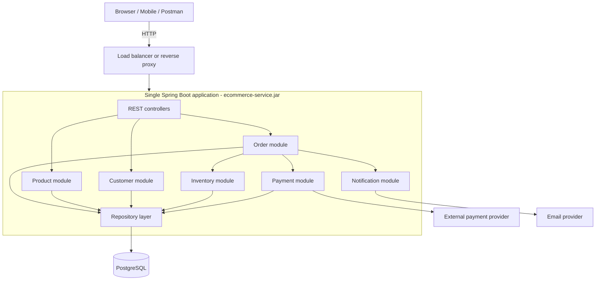

Typical deployment: `ecommerce-service.jar`. The product, order, inventory and payment modules are released together even if only the product module changes. A rolling deployment can replace instances without downtime when the system is configured appropriately.

### 2.3 Spring Boot project structure

A package-by-feature structure helps preserve business boundaries even inside one deployment unit.

```text
ecommerce-service/
├── pom.xml
└── src/main/
    ├── java/com/durgasoft/ecommerce/
    │   ├── EcommerceApplication.java
    │   ├── customer/
    │   │   ├── CustomerController.java
    │   │   ├── CustomerService.java
    │   │   └── CustomerRepository.java
    │   ├── product/
    │   ├── inventory/
    │   ├── order/
    │   │   ├── OrderController.java
    │   │   ├── OrderService.java
    │   │   └── OrderRepository.java
    │   ├── payment/
    │   └── notification/
    └── resources/application.properties
```

A package-by-layer arrangement (`controller`, `service`, `repository`) is also valid, especially for small applications. A feature-oriented modular structure is often easier to evolve as the domain grows.

### 2.4 Internal execution: placing an order

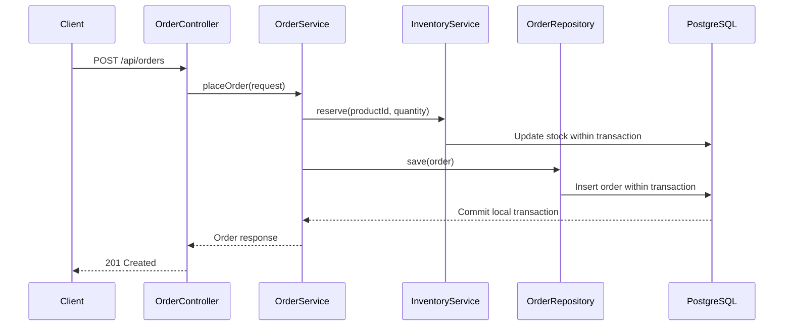

In this simplified example, inventory and order share a database and participate in one local transaction. Calls between modules do not require HTTP. In a real implementation, a concurrency-safe stock reservation is required.

```java
@Service
public class OrderService {
    private final InventoryService inventoryService;
    private final OrderRepository orderRepository;

    public OrderService(InventoryService inventoryService,
                        OrderRepository orderRepository) {
        this.inventoryService = inventoryService;
        this.orderRepository = orderRepository;
    }

    @Transactional
    public Order placeOrder(CreateOrderRequest request) {
        inventoryService.reserve(request.productId(), request.quantity());
        return orderRepository.save(Order.from(request));
    }
}
```

The code is illustrative. The domain types, imports and repository implementation are omitted. With the same transaction manager and normal transaction propagation, inventory and order changes can commit or roll back together. A database transaction does not roll back an external payment or email call. Such side effects require explicit coordination even inside a monolith.

### 2.5 Database design

A typical monolith uses one relational database with tables such as `customers`, `products`, `inventory`, `orders`, `order_items`, `payments`. Foreign keys and SQL joins can be used across these tables, subject to module boundaries.

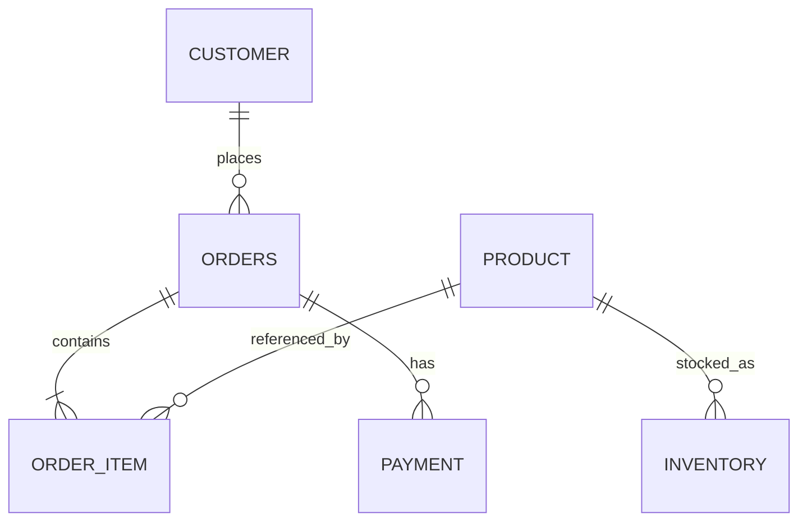

A single database is common but not a strict requirement of monolithic architecture. A modular monolith should still avoid letting every module directly modify every other module's tables.

## 3. Advantages of monolithic architecture

| Advantage | Explanation |
|---|---|
| Simple initial development | One main application to create, run and configure. |
| Easy local setup | Developers can start the backend and database without coordinating numerous service processes. |
| Simpler deployment | One application artifact and typically one main deployment pipeline. |
| Efficient internal calls | Local calls avoid network serialization and additional network hops. |
| Simpler transactions | Related changes in one database can use local ACID transactions. |
| Easier debugging initially | A local stack trace can reveal the path through several modules. |
| Simpler end-to-end testing | Fewer independently deployed dependencies to coordinate. |
| Lower initial operational overhead | Fewer runtimes, pipelines, dashboards and service identities to maintain. |
| Easier initial refactoring | A module boundary or interface can be changed within the same release. |

These benefits depend on keeping the code well structured. A very large tangled monolith may be hard to test, debug and release.

## 4. Disadvantages of monolithic architecture

| Disadvantage | Explanation |
|---|---|
| Coupled deployment | A change to one feature normally triggers a release of the whole application. |
| Coarse-grained scaling | Adding replicas usually replicates every business module, not only the busiest one. |
| Larger potential failure domain | A process crash, memory exhaustion or shared thread-pool issue can affect several capabilities in the same instance. |
| Growing coordination cost | Many teams changing the same application may face release coordination and integration conflicts. |
| Technology coupling | Modules often share a runtime and framework version, making independent upgrades harder. |
| Potential code coupling | Without enforced boundaries, features can depend on each other's internals. |

A monolith does not necessarily mean poor performance, a single machine, downtime on deployment, or an inability to serve millions of users. Replication, load balancing, caching, database tuning and modularity can address many scaling and maintainability concerns.

## 5. Microservices architecture

### 5.1 Definition

Microservices architecture divides a larger business system into separate services organized around coherent business capabilities. Each service has a well-defined interface, owns its implementation and data, and is designed to be deployed independently.

Services usually run in separate processes or containers and communicate through network APIs or messages. Service size should be determined by business boundaries, not by an arbitrary number of classes or lines of code.

### 5.2 E-commerce microservices architecture

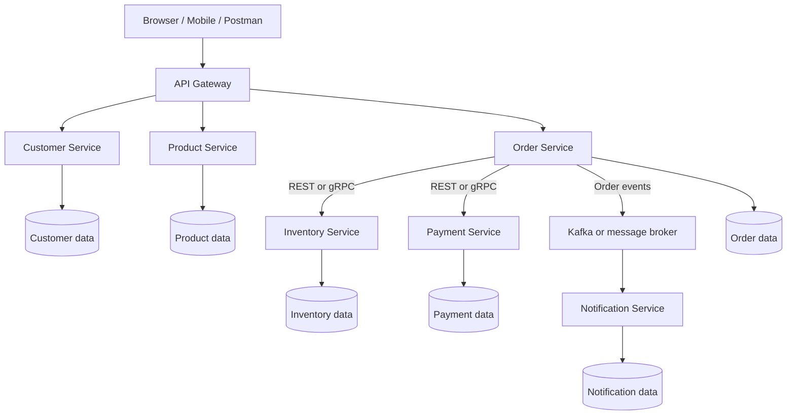

This is one possible design, not mandatory infrastructure. A system can use simple DNS instead of dedicated service discovery, and can operate without an API gateway or Kafka if the requirements do not justify them. The broker represents asynchronous events, not a mandatory component of every call.

### 5.3 Individual Spring Boot applications

| Service | Example local port | Responsibility | Owned data |
|---|---:|---|---|
| customer-service | 8081 | Customer profiles | customer_db |
| product-service | 8082 | Product catalog | product_db |
| order-service | 8083 | Order lifecycle | order_db |
| inventory-service | 8084 | Stock and reservations | inventory_db |
| payment-service | 8085 | Payment attempts and refunds | payment_db |
| notification-service | 8086 | Notification delivery | notification_db |
| api-gateway | 8080 | Public routing and cross-cutting edge policies | No business database required |

Ports and database names are examples for local training; production containers can use the same internal port on separate network identities.

```text
ecommerce-platform/
├── customer-service/       # Independent Spring Boot application
├── product-service/
├── order-service/
│   ├── pom.xml
│   └── src/main/java/com/durgasoft/order/
│       ├── OrderServiceApplication.java
│       ├── controller/
│       ├── service/
│       ├── repository/
│       ├── client/
│       └── messaging/
├── inventory-service/
├── payment-service/
├── notification-service/
└── api-gateway/
```

Separate repositories are not required. A monorepo can contain independently built and deployed services; multiple repositories alone do not imply microservices.

### 5.4 Database per service

Each service controls access to its own business data. Other services should use published APIs or events rather than modifying its tables directly. Physical database servers may be shared where appropriate, but schema ownership, access permissions, migration independence and isolation must be respected.

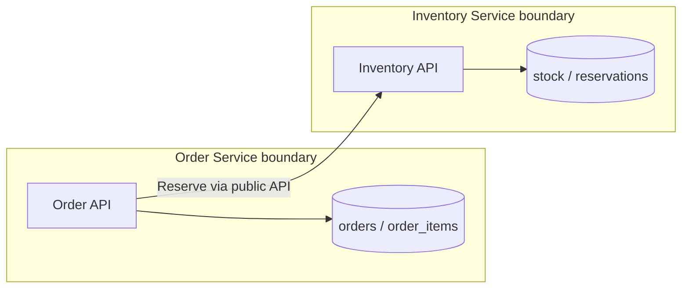

An order can store a product identifier and a price snapshot without a cross-database foreign key to the product service. A report combining data from services may use API composition or a replicated read model, instead of direct cross-service joins.

## 6. Communication in microservices

### 6.1 Synchronous communication

A caller sends a request and waits for a response. REST over HTTP and gRPC are common choices.

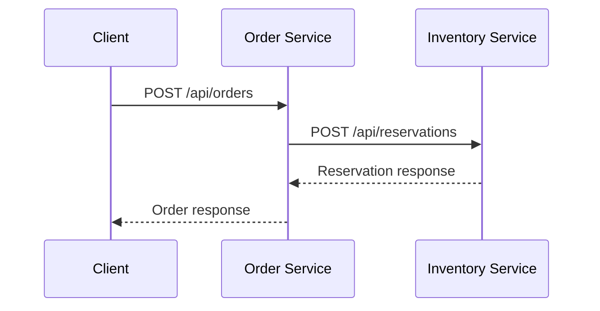

Suitable for interactions requiring an immediate answer. Risks include latency, timeouts and cascading failures. Set explicit timeouts, limit retries and ensure retryable state-changing operations are idempotent.

Spring Boot example using `RestClient` (illustrative fragment):

```java
@Service
public class InventoryClient {
    private final RestClient restClient;

    public InventoryClient(RestClient.Builder builder,
            @Value("${inventory.base-url}") String baseUrl) {
        this.restClient = builder.baseUrl(baseUrl).build();
    }

    public ReservationResponse reserve(ReservationRequest request) {
        return restClient.post()
                .uri("/api/reservations")
                .body(request)
                .retrieve()
                .body(ReservationResponse.class);
    }
}
```

```properties
inventory.base-url=http://localhost:8084
```

The snippet assumes a Boot-configured `RestClient.Builder` and defined request/response records. Production clients also require timeouts, authentication, error mapping and idempotency where relevant. A successful remote reservation is not part of the caller's local database transaction.

### 6.2 Asynchronous communication

A producer publishes a message or event. A consumer processes it independently, potentially later. Kafka and RabbitMQ are common options.

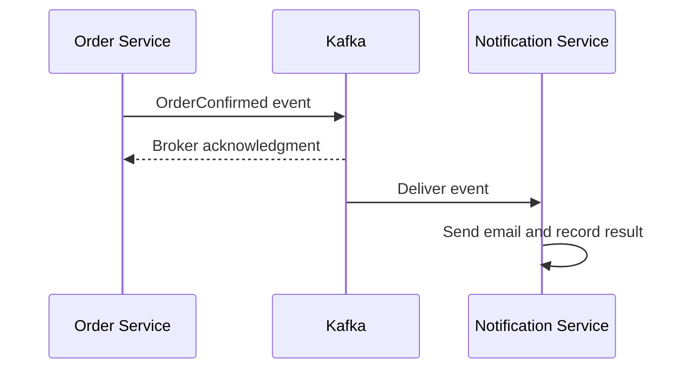

Use this when immediate completion is unnecessary, such as notifications or background processing. It can reduce temporal coupling, but requires handling delayed messages, duplicate delivery, ordering constraints and failures. In Kafka, ordering is guaranteed within a partition, not across all partitions of a topic.

Illustrative event:

```json
{
  "eventId": "evt-001",
  "eventType": "OrderConfirmed",
  "orderId": 1001,
  "customerId": 501,
  "schemaVersion": 1
}
```

### 6.3 Comparison of communication styles

| Factor | Local method call (monolith) | Synchronous network call | Asynchronous messaging |
|---|---|---|---|
| Result | Direct return | Caller waits for reply | Consumer processes separately |
| Latency | Typically lowest | Network and serialization overhead | Delivery and processing may be delayed |
| Failure | Exception/process failure | Timeout, network or remote failure | Broker or consumer failure, redelivery |
| Coupling | Code interface | Network contract and availability | Event contract and broker |
| Use | Internal module logic | Immediate query or command | Notifications and eventual workflows |

## 7. Transaction management: the important difference

### 7.1 Monolithic transaction

A single local database transaction can update stock and order state atomically. If either database operation fails and the transaction rolls back, neither change is committed.

ACID stands for Atomicity, Consistency, Isolation and Durability. This applies to the resources participating in the transaction, not automatically to external APIs or messages.

### 7.2 Distributed workflow in microservices

Each service commits its own database transaction. A payment failure after an inventory reservation does not magically undo that reservation.

A Saga is one way to coordinate a business workflow using local transactions and compensating actions. In orchestration, one component coordinates the steps; in choreography, services react to events. A compensation is a business action (such as releasing stock), not necessarily an exact reversal of history.

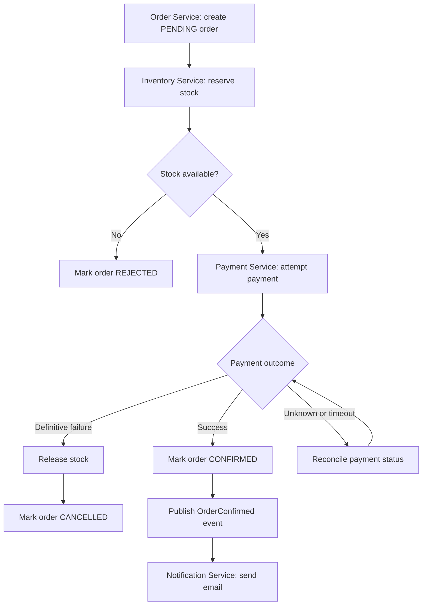

The example assumes compensation is retried safely until complete. A timeout may hide a successful payment, so reconcile unknown outcomes before treating them as failure. Track intermediate states, retries and failures durably; avoid double charging using idempotency keys. If the workflow needs to publish an event consistently with a local database update, consider the transactional outbox pattern and idempotent consumers. Eventual consistency means different services may temporarily see different states while the workflow converges; convergence requires successful processing or reconciliation, not just a broker.

## 8. Advantages of microservices architecture

| Advantage | Explanation |
|---|---|
| Independent deployment | A service can release a compatible change without redeploying all services. |
| Fine-grained scaling | Scale the service experiencing greater workload, subject to dependencies and database capacity. |
| Clearer business ownership | Teams can own a capability and its implementation, operation and data. |
| Potential fault isolation | Service process boundaries can contain some failures when callers handle unavailable dependencies. |
| Independent technology evolution | Services can upgrade their runtimes or select appropriate storage where justified. |
| Smaller service scope | A well-bounded service can be simpler to understand and modify. |
| Parallel team development | Teams can release independently when contracts and responsibilities are stable. |
| Incremental modernization | Individual services can be replaced without rebuilding the entire system. |

These are potential benefits, not automatic outcomes. Independent releases require compatible API and event changes, mature testing, and avoidance of tightly coupled data and release dependencies.

## 9. Disadvantages of microservices architecture

| Disadvantage | Explanation |
|---|---|
| Distributed-system complexity | Network calls can fail partially or behave unpredictably under load. |
| More infrastructure | More runtimes, deployments, routing, credentials and configuration to manage. |
| Data consistency challenges | Cross-service workflows cannot rely on a single ordinary local transaction. |
| More difficult debugging | A request may span services, requiring correlated logs, metrics and traces. |
| Complex testing | Contract, integration and end-to-end tests must account for network and version differences. |
| Increased latency | Remote calls add overhead; long synchronous chains can make APIs slow. |
| More security surface | Each exposed interface and service identity must be protected. |
| Higher initial operational overhead | Teams need automated builds, deployment, monitoring and incident response. |
| Boundary design difficulty | Splitting a poorly understood domain can create excessive cross-service chatter and coordinated changes. |

## 10. Monolithic vs microservices: detailed comparison

| Factor | Monolithic | Microservices |
|---|---|---|
| Deployment unit | One logical application | Multiple independent services |
| Business organization | Modules within one application | Capabilities with service boundaries |
| Internal communication | Typically local method calls | Network APIs and messages |
| Data ownership | Often one database; module ownership is possible | Service-owned data; access through contracts |
| Transactions | Local ACID across shared transactional resources | Local transactions plus distributed workflow coordination |
| Scaling | Replicate the application as a whole | Replicate individual services as needed |
| Deployment frequency | Shared release cadence | Independent cadence when contracts permit |
| Failure domain | Shared process per instance | Separate processes; cascading failures still possible |
| Performance | Lower internal-call overhead | More network overhead; independent scaling may improve overall throughput |
| Testing | Simpler local integration initially | Contract and distributed integration testing |
| Debugging | Often one process trace | Correlated logs and distributed tracing |
| Security | Fewer internal network boundaries | Service authentication and authorization in addition to edge security |
| Technology | Usually shared runtime/framework | Can vary by service, with governance |
| Team ownership | Shared application, optionally module teams | Capability-aligned teams |
| Infrastructure | Generally fewer deployment components | Generally more deployment components |
| Cost | Often lower initial overhead | Higher baseline overhead; selective scaling may save cost at scale |
| Local setup | Often one backend and database | Multiple dependencies or test substitutes |
| Refactoring | Easier to change boundaries within one release | Contract and data migration coordination |
| Best fit | Cohesive domain, small team, simpler operations | Stable boundaries, autonomous teams, justified distribution |

## 11. Scaling and deployment: practical example

Suppose product browsing gets much more traffic than payments. The following replica counts are invented for teaching, not capacity measurements or recommended sizing.

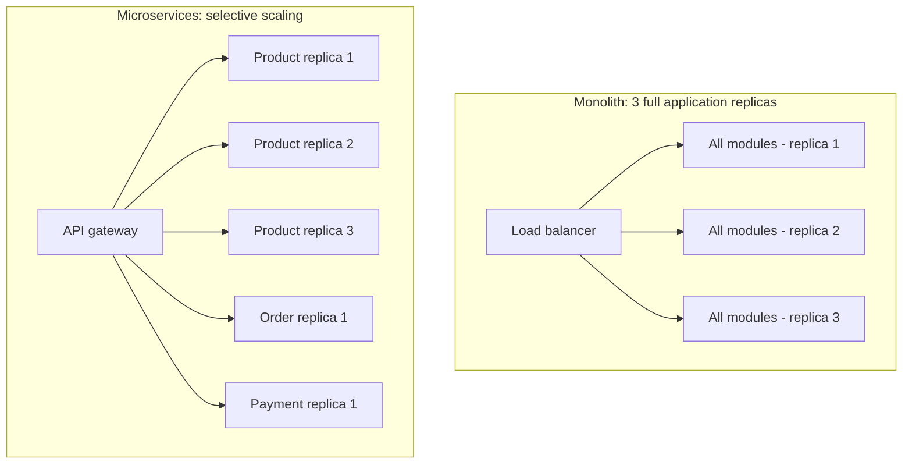

The diagram illustrates scaling granularity only. One replica of a critical service is not a high-availability production design. Actual capacity depends on workload, latency goals, CPU, memory, database limits and resilience requirements. Monoliths can also use caching, read replicas and workload isolation to handle uneven demand.

### Deployment examples

Monolith:

```bash
mvn clean package
java -jar target/ecommerce-service-0.0.1-SNAPSHOT.jar
```

Microservices (in separate terminals, with appropriate configurations):

```bash
java -jar product-service/target/product-service-0.0.1-SNAPSHOT.jar
java -jar order-service/target/order-service-0.0.1-SNAPSHOT.jar
java -jar inventory-service/target/inventory-service-0.0.1-SNAPSHOT.jar
```

Each service may have its own pipeline, artifact and rollout. Docker and Kubernetes are options, not requirements. Monoliths can also use containers and automated deployment.

## 12. When to choose monolithic architecture

Prefer a monolith, ideally modular, when:

- Building an MVP, proof of concept, training project or a new product with uncertain requirements.
- A small team owns the whole application and needs fast initial delivery.
- Most business operations are tightly related and benefit from local transactions.
- Independent scaling or release schedules are not a demonstrated requirement.
- The organization has limited capacity to run and troubleshoot distributed systems.
- Existing performance and reliability targets can be met with a simpler design.

Examples: a small employee-management system, a college project, a departmental expense tracker, a single-team internal portal and a new e-commerce MVP. A mature product can remain a monolith indefinitely if it meets its goals.

## 13. When to choose microservices architecture

Consider microservices when:

- Business capabilities are sufficiently well understood and separable.
- Multiple teams need to deploy their capabilities on independent schedules.
- Certain workloads need independently sized resources or security/failure isolation.
- The benefits of independent ownership and evolution exceed the extra infrastructure and coordination cost.
- Teams can operate distributed systems using automated deployment, service monitoring, contracts, security and incident management.
- Cross-service data workflows can meet business consistency and reliability requirements.

Examples: an established commerce platform with distinct catalog, order and payment teams; a logistics platform with independently operated tracking and fulfillment capabilities; or a SaaS platform where reporting workloads and core transactions require different resource profiles. These are illustrative scenarios, not rules that all applications in those industries must use microservices.

Do not choose microservices solely because a system has many features, a high user count, uses Spring Boot, is hosted in the cloud, or because a large technology company uses them.

## 14. Decision-making guide

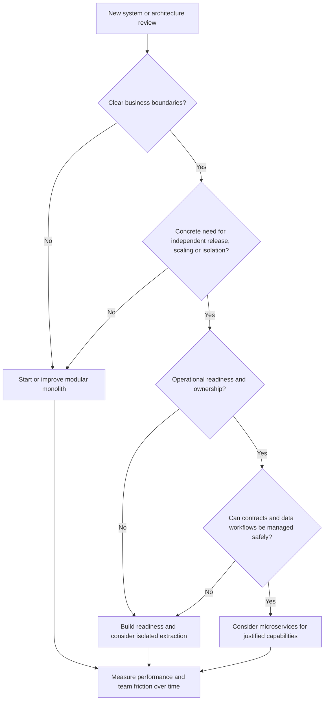

This is a qualitative teaching framework, not a numerical scoring rule. A decision should be supported by actual constraints such as release lead time, latency targets, incident history, scaling costs and team ownership.

| Scenario | Suggested starting point | Reason |
|---|---|---|
| New Employee Management Service | Modular monolith | Straightforward CRUD and simple transaction boundaries |
| New product with changing requirements | Modular monolith | Easier boundary changes and rapid learning |
| Existing large monolith with slow releases | Measure bottlenecks; modularize and selectively extract | Avoid assuming distribution alone fixes code coupling |
| Separate product and order teams needing independent releases | Consider microservices | Stable capability ownership and release autonomy |
| Reporting consumes most resources | Consider separate reporting worker/service | Isolate the specific workload rather than splitting everything |
| Payment processing needs distinct controls | Consider isolated payment capability | Separate security/operational ownership when justified; not automatic compliance |

## 15. Modular monolith: the middle ground

A modular monolith has one deployable application but explicit business modules with well-defined public interfaces and controlled dependencies. It avoids much of the operational complexity of microservices while supporting cleaner code organization.

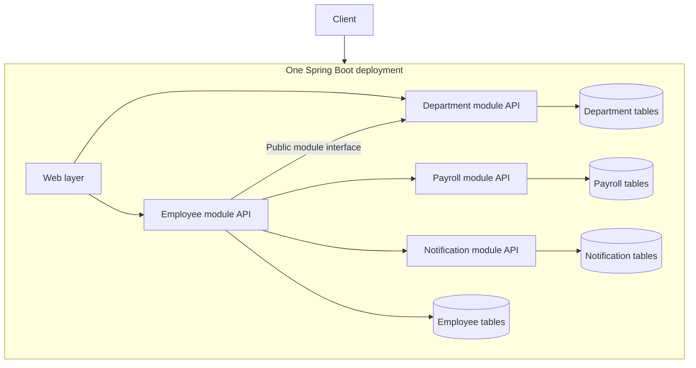

The table groups can reside in one physical database. Modules should avoid cycles, expose a small API and avoid accessing each other's internals. Spring Modulith is an optional Spring ecosystem tool that can help validate module boundaries and test modules independently. It does not turn a monolith into microservices automatically.

### Spring Boot course recommendation: Employee Management Service

Start with `employee-management-service`, package `com.durgasoft`, Java 17, Maven and PostgreSQL. Implement modules for employee, department, payroll and notification. First learn REST APIs, validation, Spring Data JPA, local transactions and testing. Then demonstrate extraction of a notification or reporting capability into a separate Spring Boot service and introduce network calls or Kafka events. This allows students to see the reason for additional distributed-system patterns.

## 16. Migrating from monolith to microservices

Prefer incremental modernization when feasible. The Strangler Fig pattern routes selected functionality to a new implementation while existing functionality remains available. A migration may stop after extracting a few services; converting every module is not necessary.

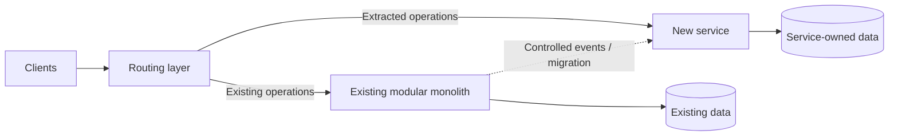

Suggested steps:

1. Measure the existing application's bottlenecks and define the desired outcome.
2. Identify a coherent business boundary, owners and dependencies.
3. Refactor the module to expose an explicit contract inside the monolith.
4. Build the separate service, deployment pipeline, monitoring and security.
5. Plan data ownership transfer, backfill, reconciliation and cutover. Avoid uncontrolled dual writes; use suitable change capture or outbox mechanisms when needed.
6. Route traffic gradually, validate business behavior and define rollback or recovery.
7. Remove obsolete code and data access only after verifying the migration.

A notification service is often a useful classroom extraction because delivery is commonly asynchronous. It still requires duplicate handling, delivery tracking and failure recovery.

## 17. Supporting technologies in a Spring Boot microservices system

| Concern | Example technology | Why use it |
|---|---|---|
| REST API | Spring MVC | Expose HTTP endpoints |
| HTTP client | RestClient or WebClient | Call another service |
| Edge routing | Spring Cloud Gateway | Route client requests, edge policies |
| Service discovery | Platform DNS or Eureka | Locate service instances |
| Configuration | Environment variables or Spring Cloud Config | Manage external settings |
| Messaging | Spring for Apache Kafka / Spring AMQP | Asynchronous communication |
| Resilience | Resilience4j | Circuit breaking, bulkheads and retry policies |
| Persistence | Spring Data JPA, PostgreSQL | Service-owned relational data |
| Security | Spring Security, OAuth 2.0 / OIDC | Authenticated and authorized access |
| Monitoring | Spring Boot Actuator, Micrometer | Health and metrics |
| Tracing | OpenTelemetry-compatible tracing | Follow requests across processes |
| Containers | Docker | Reproducible deployment packaging |
| Orchestration | Kubernetes or managed services | Scheduling and deployment automation |
| Testing | JUnit, Testcontainers, contract tests | Validate code, integration and contracts |

Choose only what the system needs. Check Spring Boot and Spring Cloud release-train compatibility before selecting dependency versions. Gateways are not substitutes for authorization within services. Never expose sensitive management endpoints publicly without suitable controls.

## 18. Common misconceptions and pitfalls

| Misconception | Reality |
|---|---|
| Monolith means one server | It can run many replicas across machines. |
| Microservices are always faster | Network calls add latency; workload and design determine performance. |
| Microservices automatically isolate failures | Synchronous dependencies can still cause cascading failures. |
| Every microservice needs its own physical database server | Logical data ownership and controlled access matter; infrastructure can be shared deliberately. |
| Every controller should become a service | Boundaries should follow business capabilities, not technical layers. |
| Microservices require Kubernetes and Kafka | Neither is mandatory. |
| Multiple Spring Boot apps automatically mean microservices | Coupled releases and shared table access can create a distributed monolith. |
| A monolith cannot use Kafka | Monoliths can use messages, caching and cloud infrastructure. |
| One architecture is always cheaper | Costs depend on workloads, operations and scaling. |
| Microservices remove the need for transactions | Each service still needs local transactions and coordinated workflows. |

A distributed monolith occurs when applications run separately but cannot evolve or deploy independently because of tightly coupled interfaces, shared data access or synchronized releases. It can combine monolithic coupling with distributed-system complexity.

## 19. Classroom exercises and discussion

### Exercise A — design a modular monolith

Create a Spring Boot application `employee-management-service` using `com.durgasoft`. Use modules for employees and departments, one PostgreSQL database, and REST endpoints for creating an employee and viewing department information. Discuss how to keep module interfaces explicit and test local transactions.

### Exercise B — split one capability

Introduce a separate `notification-service` under `com.durgasoft.notification`. Keep employee data owned by the employee service. Send an `EmployeeCreated` event containing a unique event ID and the minimum necessary notification data. Simulate a consumer outage and duplicate delivery. Decide whether employee creation should succeed when notification delivery fails. Explain how an outbox and idempotent consumer can support reliability.

### Exercise C — architecture selection

Discuss these scenarios in class:

- A startup with three developers needs to release an MVP quickly. Why might a modular monolith be appropriate?
- Product search traffic is ten times higher than ordering traffic. Can caching or replication solve the problem before extracting a service?
- A payment request times out. Why is retrying blindly dangerous?
- Two services must always release together. What architectural coupling might be present?
- An order is saved but its confirmation event was not published. How would an outbox help?

## 20. Interview questions and answers

**1. What is a monolithic architecture?** One logical deployable application containing multiple business capabilities.

**2. What is a microservices architecture?** A system of independently deployable services organized around business capabilities with explicit communication contracts.

**3. Can a monolith scale horizontally?** Yes. Replicate the application behind a load balancer, subject to shared state and database constraints.

**4. What is the main deployment difference?** A monolith is released as one unit; microservices are designed for independent releases.

**5. Why should microservices own their data?** To reduce coupling, control schema evolution and preserve service autonomy.

**6. What is an API gateway?** An optional edge component routing requests to backend services and applying appropriate cross-cutting policies.

**7. What is a Saga?** A business workflow coordinated through local transactions and compensating actions across services.

**8. What is eventual consistency?** A model in which separated data views may temporarily differ and are brought into agreement through processing or reconciliation.

**9. What is a circuit breaker?** A resilience mechanism that temporarily limits calls to a failing dependency to avoid repeated costly failures.

**10. What is idempotency?** Repeating the same logical operation does not produce additional unintended effects, for example charging a customer twice.

**11. What is a modular monolith?** One deployment unit with explicit, controlled business module boundaries.

**12. Is Spring Boot required for microservices?** No. Spring Boot is one framework that supports both styles.

**13. Can microservices share a Git repository?** Yes. Independent deployability and ownership matter more than repository layout.

**14. Which architecture should a new application use?** Start with the simplest architecture that meets actual requirements, often a modular monolith; choose distribution when its benefits justify the cost.

