## Table of contents

1. [Introduction to Spring Boot](#1-introduction-to-spring-boot)
2. [Types of applications](#2-what-kind-of-applications-can-we-build-using-spring-boot)
3. [Spring Framework vs Spring Boot](#3-spring-framework-vs-spring-boot)
4. [Advantages of Spring Boot](#4-advantages-of-spring-boot)
5. [Employee Management Service](#5-employee-management-service)
6. [Project creation steps](#6-steps-to-create-the-spring-boot-application)
7. [Project structure](#7-understanding-the-project-structure)
8. [Main application class](#8-understanding-the-main-application-class)
9. [Spring Web starter](#9-spring-web-starter-dependency-in-detail)
10. [First REST endpoint](#10-developing-the-first-rest-endpoint)
11. [Returning objects as JSON](#11-returning-employee-objects-as-json)
12. [Internal request execution](#12-internal-execution-flow-of-spring-web)
13. [Application configuration](#13-configuring-application-properties)
14. [Packaging and deployment](#14-building-and-packaging-the-application)
15. [Troubleshooting](#15-common-errors-and-troubleshooting)
16. [Interview questions](#16-classroom-and-interview-questions)
17. [Hands-on assignments](#17-hands-on-assignments)
18. [Learning roadmap](#18-spring-boot-learning-roadmap)
19. [References](#19-official-references)

---

## 1. Introduction to Spring Boot

Spring Boot is an open-source framework built on top of the Spring Framework that simplifies the development, configuration, testing and deployment of Java applications.

It allows developers to concentrate on **business logic rather than infrastructure configuration**. It provides starter dependencies, auto-configuration, embedded web servers, dependency version management, externalized configuration and production monitoring capabilities.

Spring Boot does not replace Spring Framework. It uses Spring Framework's core capabilities and provides a convenient way to configure and run applications.

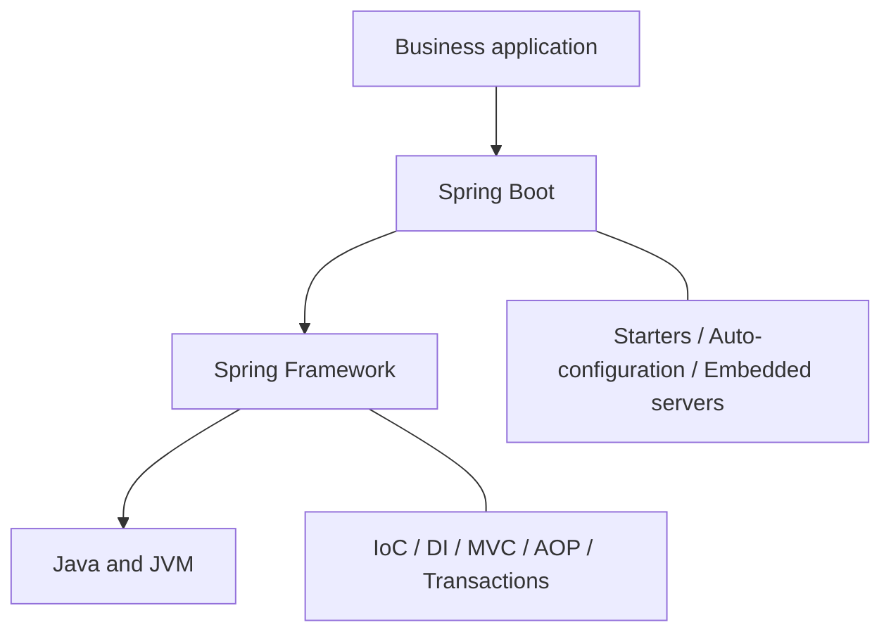

**Simple analogy:** Spring Framework supplies the building materials and tools; Spring Boot supplies a ready-to-use foundation with sensible defaults. Developers can still customize that foundation as required.

---

## 2. What kind of applications can we build using Spring Boot?

Spring Boot can be used to build standalone, enterprise and distributed applications. It is not limited to REST APIs or microservices.

| Application type | Description | Real-world examples | Technologies |
|---|---|---|---|
| Web applications | Browser-based applications, including server-rendered websites | Shopping portals, employee portals, banking portals | Spring MVC, Thymeleaf, Spring Security |
| REST API applications | Backend services exposing HTTP endpoints, commonly using JSON | Employee, Product, Customer and Payment APIs | Spring Web MVC, Jackson |
| Microservices | Independently deployable services organized around business capabilities | Order, Payment, Inventory and Notification services | Spring Boot, Spring Cloud, Docker, Kubernetes |
| Database-driven applications | Applications that store, retrieve, update and delete information | Hospital management, payroll, CRM | Spring Data JPA, Hibernate, PostgreSQL, MySQL, MongoDB |
| Messaging and event-driven applications | Applications exchanging messages or events asynchronously | Order processing, email notifications, transaction processing | Kafka, RabbitMQ, JMS, ActiveMQ |
| Batch and scheduled applications | Large-volume or periodic processing | Salary processing, report generation, billing, file import | Spring Batch, Spring Scheduler, Quartz |
| Cloud-native applications | Applications designed for cloud deployment and operation | SaaS platforms, distributed banking, e-commerce | AWS, Azure, GCP, Docker, Kubernetes |
| Reactive applications | Applications using non-blocking processing for suitable I/O workloads | Streaming APIs, real-time dashboards, notifications | Spring WebFlux, Project Reactor |
| Generative AI applications | Java applications integrated with AI models and services | AI chatbots, RAG, document assistants, semantic search | Spring AI, OpenAI, Ollama, vector databases |
| Standalone applications | Command-line or background applications without an HTTP server | Migration utilities, file conversion, data processing | CommandLineRunner, ApplicationRunner, Spring Shell |

### 2.1 Real-world example: E-commerce application

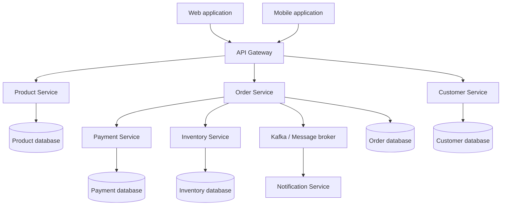

Each backend service can be implemented as an independent Spring Boot application. The frontend may be built using Angular, React or other technologies. An API gateway, message broker, databases and caching can be added as the requirements grow.

Spring Boot also supports a modular monolith. Microservices are an architectural choice, not a requirement imposed by Spring Boot.

---

## 3. Spring Framework vs Spring Boot

### 3.1 What is Spring Framework?

Spring Framework provides foundational infrastructure for enterprise Java applications.

Its core features include:

- Inversion of Control (IoC) and Dependency Injection (DI).
- Bean discovery, creation and lifecycle management.
- Aspect-Oriented Programming (AOP).
- Spring MVC for servlet-based web development.
- Transaction management and database integration.
- Integration with other Java technologies.

When we use Spring Framework directly, we may need to explicitly configure infrastructure beans, web application initialization, servlet registration and dependencies.

### 3.2 What is Spring Boot?

Spring Boot builds on Spring Framework and provides conventions and conditional defaults to reduce initial configuration. We can override these defaults whenever necessary.

### 3.3 Comparison

| Feature | Spring Framework without Boot | Spring Boot |
|---|---|---|
| Purpose | Foundation for enterprise applications | Simplifies Spring application development |
| Configuration | More explicit configuration | Conditional auto-configuration |
| Dependencies | Select libraries individually | Predefined starters |
| Version management | Developer-managed or Spring BOM | Boot-managed compatible versions |
| Web server | Explicit setup or deployment | Embedded server support |
| XML | Optional; Java configuration is supported | Usually unnecessary |
| Application startup | Depends on application setup | Commonly a Java main method |
| Deployment | JAR or WAR with suitable setup | Executable JAR or WAR |
| Initial development effort | More infrastructure setup | Faster initial setup |
| Monitoring | Additional integration needed | Actuator integration available |
| Defaults | Fewer application-level conventions | Opinionated, customizable defaults |
| Microservices | Possible | Simplified development and deployment |
| Flexibility | High | High; defaults can be overridden |

### 3.4 Configuration example

Traditional Spring MVC Java configuration:

```java
@Configuration
@ComponentScan(basePackages = "com.durgasoft")
@EnableWebMvc
public class AppConfig {
}
```

This is only a configuration fragment. A traditional application may additionally require servlet initialization, dependency setup and a web server.

Spring Boot application configuration:

```java
@SpringBootApplication
public class EmployeeManagementServiceApplication {

    public static void main(String[] args) {
        SpringApplication.run(
            EmployeeManagementServiceApplication.class, args
        );
    }
}
```

With the appropriate web starter, Boot configures much of the required MVC infrastructure automatically.

**Key point:** Spring Boot is not a replacement for Spring Framework. It is a simplified way of building Spring-based applications.

---

## 4. Advantages of Spring Boot

### 4.1 Auto-configuration

Spring Boot configures infrastructure conditionally based on the dependencies available on the classpath, application properties, existing beans and application type.

For example, the Spring Web MVC starter enables Boot to configure a servlet web application with embedded Tomcat, MVC infrastructure and HTTP message converters.

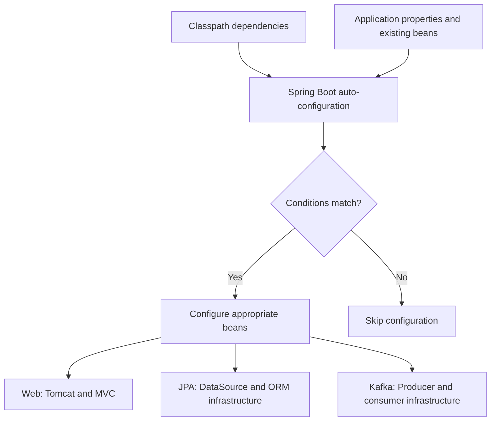

The JPA and Kafka examples require their respective dependencies and appropriate settings. Auto-configuration does not install an external database or message broker.

### 4.2 Starter dependencies

A starter is a predefined collection of related dependencies. Rather than adding and coordinating individual libraries manually, we select a starter that represents the required capability.

| Spring Boot 4 starter | Purpose |
|---|---|
| `spring-boot-starter-webmvc` | Servlet-based MVC and REST APIs |
| `spring-boot-starter-data-jpa` | JPA database operations |
| `spring-boot-starter-security` | Authentication and authorization |
| `spring-boot-starter-validation` | Bean validation |
| `spring-boot-starter-actuator` | Health and monitoring |
| `spring-boot-starter-test` | Common testing utilities |
| `spring-boot-starter-data-redis` | Redis integration |
| `spring-boot-starter-kafka` | Apache Kafka integration |
| `spring-boot-starter-webflux` | Reactive web applications |
| `spring-boot-starter-batch` | Batch processing |

### 4.3 Embedded web server

Traditional servlet applications are commonly packaged as WAR files and deployed to an external servlet container. Spring Boot can package an embedded server inside the executable application.

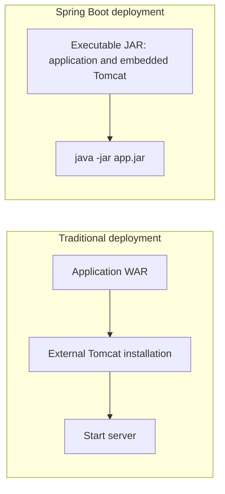

Tomcat is the default embedded servlet container for the MVC starter. Other supported servers may be selected by changing dependencies. Spring Boot can also be used without a web server.

### 4.4 Reduced boilerplate configuration

Boot reduces the need to manually configure servlet registration, MVC components, message converters, server initialization and other standard infrastructure.

### 4.5 Rapid application development

Spring Initializr generates a project with a build file, selected dependencies, application class, resources and testing setup. Developers can start implementing business requirements quickly.

### 4.6 Dependency version management

Spring Boot's parent POM or dependency management BOM supplies compatible versions for many commonly used libraries. Developers usually do not specify versions for Boot-managed dependencies.

### 4.7 Externalized configuration

Application behavior can be customized using properties files, YAML files, environment variables and command-line arguments.

```properties
spring.application.name=employee-management-service
server.port=9090
```

Changing the port does not require changing Java source code.

### 4.8 Environment-specific configuration

Spring profiles allow configuration to vary by environment.

```text
application.properties
application-dev.properties
application-qa.properties
application-prod.properties
```

Example activation in the base configuration:

```properties
spring.profiles.active=dev
```

Alternatively, set the environment variable `SPRING_PROFILES_ACTIVE=dev`. Do not commit production credentials to source control.

### 4.9 Production-ready features

Spring Boot Actuator provides monitoring and management endpoints when its dependency is added.

| Endpoint | Purpose |
|---|---|
| `/actuator/health` | Application health |
| `/actuator/info` | Application information, when configured |
| `/actuator/metrics` | Application metrics |
| `/actuator/loggers` | Logging levels |
| `/actuator/beans` | Registered beans |
| `/actuator/mappings` | Request mappings |

Not all endpoints are exposed over HTTP by default. Expose only what is needed and secure sensitive endpoints appropriately.

### 4.10 Simplified testing

Boot supports JUnit, Mockito, Spring Boot Test, MVC testing with MockMvc and integration testing. Spring Boot 4 also offers technology-specific test starters.

### 4.11 Easy deployment and integration

An executable JAR can run on a suitable JVM on physical servers, virtual machines, containers and cloud platforms. Spring Boot also simplifies integration with relational and NoSQL databases, Redis, messaging brokers, security frameworks and AI services.

---

## 5. Employee Management Service

### 5.1 Application objective

Develop a backend application to manage employee information such as ID, name, department and salary.

The target application will eventually expose the following CRUD APIs:

| HTTP method | Endpoint | Operation |
|---|---|---|
| GET | `/api/employees` | Retrieve all employees |
| GET | `/api/employees/101` | Retrieve an employee by ID |
| POST | `/api/employees` | Create an employee |
| PUT | `/api/employees/101` | Update an employee |
| DELETE | `/api/employees/101` | Delete an employee |

**In this first session:** implement GET endpoints returning text, a single employee and a list of employees, without a database. The complete CRUD endpoints listed above are future scope.

### 5.2 Target architecture

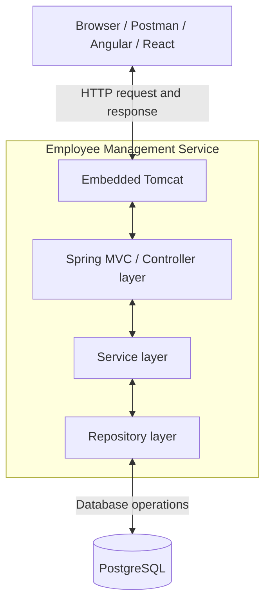

| Layer | Responsibility |
|---|---|
| Controller | Receives HTTP requests and returns responses |
| Service | Implements business rules |
| Repository | Performs persistence operations |
| Database | Stores application data |

Only the web server, MVC infrastructure, controller and simple model are implemented in this first demo.

---

## 6. Steps to create the Spring Boot application

### Step 1: Install prerequisites

| Software | Purpose |
|---|---|
| Java 17 or compatible newer JDK | Compile and run Java code |
| Maven or Maven Wrapper | Build and manage dependencies |
| IntelliJ IDEA / STS / Eclipse | Development environment |
| Postman | Test REST endpoints |
| Browser | Test GET endpoints |

Check the Java installation:

```bash
java -version
```

If Maven is installed separately:

```bash
mvn -version
```

The Maven Wrapper generated by Spring Initializr can be used without installing Maven globally.

### Step 2: Open Spring Initializr

Visit [https://start.spring.io](https://start.spring.io).

Spring Initializr is a web-based tool used to generate a Spring Boot project with the selected dependencies and configuration.

### Step 3: Enter project metadata

| Field | Select / Enter | Explanation |
|---|---|---|
| Project | Maven | Build tool |
| Language | Java | Programming language |
| Spring Boot | Stable 4.x release | Framework version; avoid SNAPSHOT and milestone releases for this demo |
| Group | `com.durgasoft` | Organization identifier |
| Artifact | `employee-management-service` | Project artifact identifier |
| Name | `employee-management-service` | Application name |
| Description | Employee Management REST API | Application purpose |
| Package name | `com.durgasoft` | Base package for Java classes |
| Packaging | Jar | Executable JAR packaging |
| Java | 17 | Java version |

**Why Maven?** It downloads dependencies, compiles Java source code, runs tests and packages the application.

**Why JAR?** It allows the web application to run as an independent process with its embedded web server, without requiring a separately installed Tomcat instance.

### Step 4: Add the dependency

Click **Add Dependencies** and select the servlet-based **Spring Web MVC** option (the display label may be Spring Web, depending on the Initializr version). For Boot 4, verify the generated POM contains `spring-boot-starter-webmvc`.

Do not select Spring Reactive Web for this MVC demonstration.

### Step 5: Generate the project

Click **Generate**. Extract the downloaded `employee-management-service.zip` into your workspace.

### Step 6: Import into the IDE

- IntelliJ IDEA: Open the extracted folder containing `pom.xml` and allow Maven synchronization.
- Eclipse / Spring Tool Suite: File → Import → Maven → Existing Maven Projects. Select the extracted directory and finish the import.

Maven downloads the required dependencies. Ensure the IDE uses the selected JDK.

---

## 7. Understanding the project structure

```text
employee-management-service/
├── .mvn/
├── mvnw
├── mvnw.cmd
├── pom.xml
└── src/
    ├── main/
    │   ├── java/
    │   │   └── com/durgasoft/
    │   │       └── EmployeeManagementServiceApplication.java
    │   └── resources/
    │       ├── static/
    │       ├── templates/
    │       └── application.properties
    └── test/
        └── java/com/durgasoft/
            └── EmployeeManagementServiceApplicationTests.java
```

Generated directories may vary with the Initializr and Boot versions selected.

| File or directory | Purpose |
|---|---|
| `src/main/java` | Application Java source code |
| `src/main/resources` | Configuration and other resources |
| `application.properties` | Application settings |
| `static` | Static HTML, CSS, JavaScript and images |
| `templates` | Server-side view templates, when a template engine is configured |
| `src/test/java` | Test classes |
| `pom.xml` | Maven project configuration |
| `mvnw` | Maven Wrapper for Linux/macOS |
| `mvnw.cmd` | Maven Wrapper for Windows |
| `.mvn` | Maven Wrapper configuration |
| `target` | Build output, created when Maven builds the application |

### 7.1 Understanding `pom.xml`

A Maven POM declares project identity, dependencies, build plugins and configuration. The generated POM contains a concrete Spring Boot parent version, Java version, web starter, test dependencies and the Spring Boot Maven plugin.

Important web dependency for Spring Boot 4:

```xml
<dependency>
    <groupId>org.springframework.boot</groupId>
    <artifactId>spring-boot-starter-webmvc</artifactId>
</dependency>
```

The Spring Boot Maven plugin packages the application into an executable archive:

```xml
<build>
    <plugins>
        <plugin>
            <groupId>org.springframework.boot</groupId>
            <artifactId>spring-boot-maven-plugin</artifactId>
        </plugin>
    </plugins>
</build>
```

These are POM excerpts; retain the complete POM generated by Spring Initializr, including its actual Boot version and test dependencies.

---

## 8. Understanding the main application class

File: `src/main/java/com/durgasoft/EmployeeManagementServiceApplication.java`

```java
package com.durgasoft;

import org.springframework.boot.SpringApplication;
import org.springframework.boot.autoconfigure.SpringBootApplication;

@SpringBootApplication
public class EmployeeManagementServiceApplication {

    public static void main(String[] args) {
        SpringApplication.run(
            EmployeeManagementServiceApplication.class,
            args
        );
    }
}
```

### 8.1 What is `@SpringBootApplication`?

It combines three important annotations:

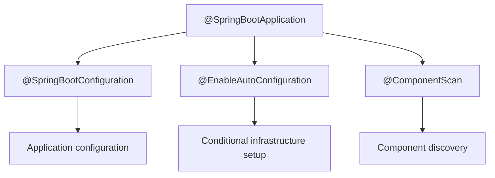

| Annotation | Responsibility |
|---|---|
| `@SpringBootConfiguration` | Specialization of `@Configuration`; identifies Boot configuration and supports bean declarations |
| `@EnableAutoConfiguration` | Enables conditional configuration of application infrastructure |
| `@ComponentScan` | Discovers Spring-managed components in the base package and its subpackages |

With the main class in `com.durgasoft`, default component scanning covers:

```text
com.durgasoft
├── EmployeeManagementServiceApplication
├── controller
│   └── EmployeeController
├── service
│   └── EmployeeService
└── repository
    └── EmployeeRepository
```

Classes annotated with `@Component`, `@Service`, `@Repository`, `@Controller` or `@RestController` can be discovered in these packages. The service and repository shown here are future application layers.

### 8.2 What is `SpringApplication.run()`?

This method bootstraps the application: prepares configuration and environment, creates the application context, registers bean definitions, initializes managed objects, applies auto-configuration and starts the embedded server when required.

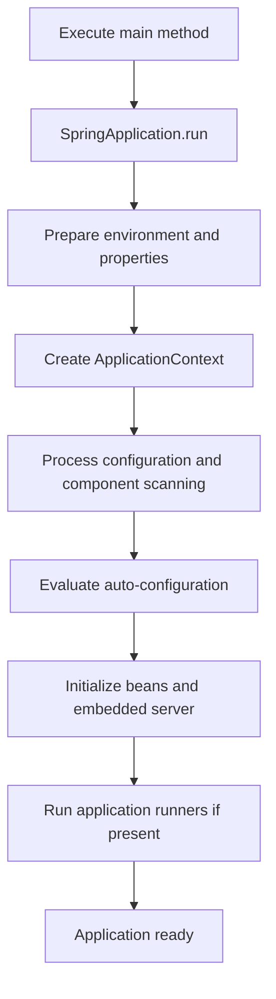

This is a simplified conceptual startup flow, not an exact method-by-method lifecycle trace.

---

## 9. Spring Web starter dependency in detail

### 9.1 What is Spring Web Starter?

The web starter is a set of dependencies for developing servlet-based web applications and REST services. It supplies infrastructure for HTTP request handling, routing, request data binding, REST responses, JSON conversion and exception handling. With Boot's auto-configuration, the application can start an embedded servlet container.

### 9.2 Spring Boot 3 vs Spring Boot 4 dependency

**Spring Boot 3.x:**

```xml
<dependency>
    <groupId>org.springframework.boot</groupId>
    <artifactId>spring-boot-starter-web</artifactId>
</dependency>
```

**Spring Boot 4.x (preferred for new MVC projects):**

```xml
<dependency>
    <groupId>org.springframework.boot</groupId>
    <artifactId>spring-boot-starter-webmvc</artifactId>
</dependency>
```

Spring Boot 4 deprecates the older `spring-boot-starter-web` starter in favor of `spring-boot-starter-webmvc`. See the [official starter list](https://docs.spring.io/spring-boot/4.0/reference/using/build-systems.html).

### 9.3 Why do we need this dependency?

Consider a client request:

```http
GET /api/employees HTTP/1.1
Host: localhost:8080
Accept: application/json
```

For this request to succeed, the backend needs several capabilities:

| Requirement | Component |
|---|---|
| Accept HTTP connections | Embedded Tomcat |
| Dispatch requests | DispatcherServlet |
| Locate controller method | Spring MVC HandlerMapping |
| Invoke method | HandlerAdapter |
| Bind parameters and request body | MVC argument resolution and message converters |
| Convert Java objects into JSON | Jackson-based HTTP message converter |
| Return HTTP response | Servlet and MVC infrastructure |
| Configure infrastructure | Spring Boot auto-configuration |
| Record logs | Default logging infrastructure |

Instead of adding and configuring all these components individually, we use the MVC starter.

### 9.4 What dependencies and capabilities does it provide?

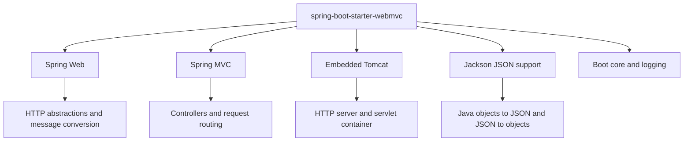

This diagram is conceptual; it does not represent an exact Maven direct/transitive dependency tree. In Spring Boot 4, the modular starter structure includes technology-specific Boot modules.

#### A. Spring Web

Provides foundational web infrastructure such as HTTP request and response abstractions, annotations, HTTP headers, status codes and message conversion support.

Common annotations include:

| Annotation | Purpose |
|---|---|
| `@RestController` | REST controller |
| `@RequestMapping` | Common URL mapping |
| `@GetMapping` | HTTP GET |
| `@PostMapping` | HTTP POST |
| `@PutMapping` | HTTP PUT |
| `@DeleteMapping` | HTTP DELETE |
| `@PathVariable` | Read a value from the URL path |
| `@RequestParam` | Read a request parameter |
| `@RequestBody` | Bind the HTTP request body to a Java object |

#### B. Spring MVC

Spring MVC is a servlet-based web framework that handles routing, request binding, invocation of application controllers and response processing.

| Component | Responsibility |
|---|---|
| DispatcherServlet | Central front controller |
| HandlerMapping | Identifies an appropriate handler |
| HandlerAdapter | Invokes the selected handler |
| Controller | Executes endpoint logic |
| HttpMessageConverter | Reads or writes HTTP bodies |
| HandlerExceptionResolver | Resolves exceptions during MVC processing |

#### C. Embedded Tomcat

Tomcat is the default servlet container for the Spring MVC web starter. It runs inside the application process, accepts HTTP connections, manages request processing and passes requests into the servlet infrastructure.

Default HTTP port: `8080` (unless overridden).

#### D. Jackson – JSON serialization and deserialization

**Serialization** means converting a Java object into JSON.

```java
Employee employee = new Employee(101L, "Ravi", "IT", 50000.0);
```

Example JSON response:

```json
{
    "id": 101,
    "name": "Ravi",
    "department": "IT",
    "salary": 50000.0
}
```

**Deserialization** means converting JSON into a Java object. For example, a future POST endpoint accepting `@RequestBody Employee employee` can receive this JSON:

```json
{
    "id": 102,
    "name": "Priya",
    "department": "HR",
    "salary": 45000.0
}
```

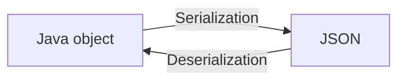

Spring MVC uses configured message converters to perform these operations. Spring Boot 4 prefers Jackson 3 by default. There is no need to manually call a JSON library for ordinary REST responses.

#### E. Logging

Boot's default logging setup commonly uses Logback with SLF4J. Logging helps developers observe startup, configuration, application behavior and errors.

### 9.5 Direct vs transitive dependencies

A **direct dependency** is explicitly declared in `pom.xml`. A **transitive dependency** is brought in indirectly by another dependency.

Use the Maven dependency tree to see the actual dependency graph for your selected Boot version:

```bash
mvn dependency:tree
```

Windows PowerShell:

```powershell
.\mvnw.cmd dependency:tree
```

Linux/macOS:

```bash
./mvnw dependency:tree
```

Identify Tomcat, Spring Web, Spring MVC, Jackson and logging libraries in the output.

### 9.6 What happens without the web starter?

If no other dependency provides the necessary MVC and servlet infrastructure, the application cannot run these servlet-based REST endpoints. It can still run as a non-web application when configured appropriately.

The web starter does not automatically provide JPA, a PostgreSQL database, authentication, caching or Kafka. Add the appropriate dependencies when those features are required.

---

## 10. Developing the first REST endpoint

### Step 1: Create the controller package

Create `com.durgasoft.controller` under `src/main/java`.

### Step 2: Create EmployeeController.java

```java
package com.durgasoft.controller;

import org.springframework.web.bind.annotation.GetMapping;
import org.springframework.web.bind.annotation.RequestMapping;
import org.springframework.web.bind.annotation.RestController;

@RestController
@RequestMapping("/api/employees")
public class EmployeeController {

    @GetMapping("/welcome")
    public String welcome() {
        return "Welcome to Employee Management Service";
    }
}
```

| Annotation | Explanation |
|---|---|
| `@RestController` | Registers a Spring MVC REST controller |
| `@RequestMapping` | Sets a common base path for methods in the class |
| `@GetMapping` | Maps a GET request to a controller method |

`@RestController` combines `@Controller` and `@ResponseBody` behavior. Return values are written to the response body rather than interpreted as view names.

### Step 3: Understand the endpoint

```text
http://localhost:8080/api/employees/welcome
```

| URL part | Meaning |
|---|---|
| `http://` | Protocol |
| `localhost` | Local computer |
| `8080` | Server port |
| `/api/employees` | Class-level mapping |
| `/welcome` | Method-level mapping |

### Step 4: Run the application

Run `EmployeeManagementServiceApplication.java` as a Java application in the IDE, or execute:

```bash
mvn spring-boot:run
```

Windows PowerShell:

```powershell
.\mvnw.cmd spring-boot:run
```

Linux/macOS:

```bash
./mvnw spring-boot:run
```

Illustrative console output (exact wording varies by version):

```text
:: Spring Boot :: (v4.x.x)
Starting EmployeeManagementServiceApplication
Tomcat initialized with port 8080 (http)
Root WebApplicationContext initialized
Tomcat started on port 8080 (http)
Started EmployeeManagementServiceApplication
```

### Step 5: Test using a browser or Postman

| Setting | Value |
|---|---|
| Method | GET |
| URL | `http://localhost:8080/api/employees/welcome` |
| Expected status | `200 OK` |
| Expected content type | `text/plain` for an ordinary text request |

Expected body:

```text
Welcome to Employee Management Service
```

Command-line test:

```bash
curl -i http://localhost:8080/api/employees/welcome
```

On Windows PowerShell, use `curl.exe` if `curl` is an alias for a PowerShell command.

---

## 11. Returning Employee objects as JSON

### Step 1: Create the model package

Create `com.durgasoft.model` and add the following file.

**Employee.java**

```java
package com.durgasoft.model;

public record Employee(
    Long id,
    String name,
    String department,
    Double salary
) {
}
```

A Java record is a concise data carrier that automatically provides a canonical constructor, component accessor methods, `equals()`, `hashCode()` and `toString()`.

For this introductory demo, `Double` is used for simplicity. In production, prefer `BigDecimal` for monetary values.

### Step 2: Replace EmployeeController.java with the following code

```java
package com.durgasoft.controller;

import com.durgasoft.model.Employee;
import org.springframework.web.bind.annotation.GetMapping;
import org.springframework.web.bind.annotation.RequestMapping;
import org.springframework.web.bind.annotation.RestController;

import java.util.List;

@RestController
@RequestMapping("/api/employees")
public class EmployeeController {

    @GetMapping("/welcome")
    public String welcome() {
        return "Welcome to Employee Management Service";
    }

    @GetMapping("/sample")
    public Employee getEmployee() {
        return new Employee(101L, "Ravi", "IT", 50000.0);
    }

    @GetMapping
    public List<Employee> getEmployees() {
        return List.of(
            new Employee(101L, "Ravi", "IT", 50000.0),
            new Employee(102L, "Priya", "HR", 45000.0),
            new Employee(103L, "Kiran", "Finance", 60000.0)
        );
    }
}
```

### Step 3: Final Java package structure

```text
src/main/java/com/durgasoft/
├── EmployeeManagementServiceApplication.java
├── controller/
│   └── EmployeeController.java
└── model/
    └── Employee.java
```

### Step 4: Restart and test all APIs

#### Test 1: Return a text response

```http
GET http://localhost:8080/api/employees/welcome
```

Expected status: `200 OK`.

```text
Welcome to Employee Management Service
```

#### Test 2: Return a single Employee object

```http
GET http://localhost:8080/api/employees/sample
Accept: application/json
```

Expected status: `200 OK`; content type: `application/json`.

```json
{
    "id": 101,
    "name": "Ravi",
    "department": "IT",
    "salary": 50000.0
}
```

#### Test 3: Return a list of employees

```http
GET http://localhost:8080/api/employees
Accept: application/json
```

Expected status: `200 OK`; content type: `application/json`.

```json
[
    {
        "id": 101,
        "name": "Ravi",
        "department": "IT",
        "salary": 50000.0
    },
    {
        "id": 102,
        "name": "Priya",
        "department": "HR",
        "salary": 45000.0
    },
    {
        "id": 103,
        "name": "Kiran",
        "department": "Finance",
        "salary": 60000.0
    }
]
```

JSON whitespace and property order may differ depending on configuration.

**Observation:** The controller returns Java objects directly. Spring MVC selects a suitable HTTP message converter and serializes the objects to JSON. We do not have to construct JSON strings manually.

---

## 12. Internal execution flow of Spring Web

When a client sends `GET /api/employees/sample`, the HTTP request passes through the embedded server and MVC infrastructure before invoking our Java method.

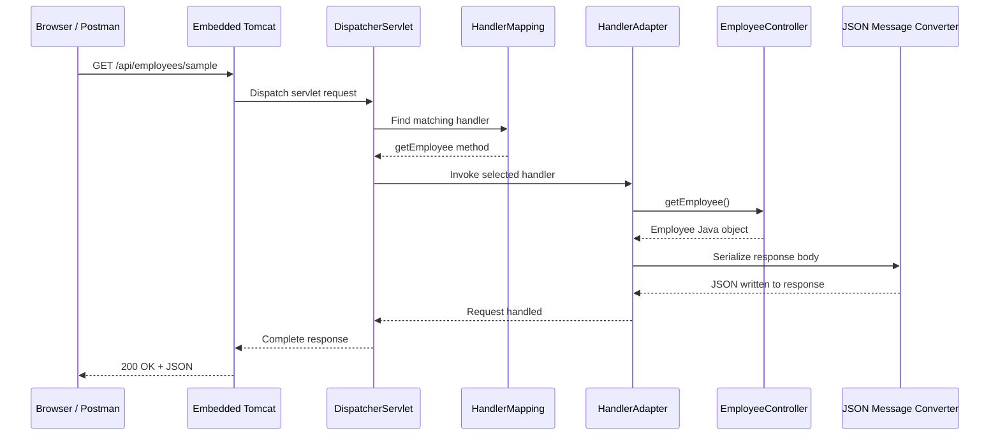

| Step | Operation |
|---|---|
| 1 | Client sends an HTTP GET request. |
| 2 | Embedded Tomcat accepts the request and passes it to the servlet infrastructure. |
| 3 | DispatcherServlet acts as the central MVC request dispatcher. |
| 4 | HandlerMapping locates the controller method associated with the URL and HTTP method. |
| 5 | HandlerAdapter invokes the selected controller, resolving method arguments where required. |
| 6 | EmployeeController creates and returns an Employee object. |
| 7 | MVC return-value handling selects the Jackson-backed message converter to serialize the response. |
| 8 | HTTP response is completed with status, headers and body. |
| 9 | Tomcat sends the response to the client. |

This is a simplified successful request flow. Filters, interceptors, content negotiation, exception resolvers and other infrastructure may also participate.

---

## 13. Configuring application properties

File: `src/main/resources/application.properties`

```properties
spring.application.name=employee-management-service
server.port=8080
```

### 13.1 Change the server port

```properties
spring.application.name=employee-management-service
server.port=9090
```

Restart the application. The new URL is:

```text
http://localhost:9090/api/employees
```

### 13.2 Configure a context path

```properties
spring.application.name=employee-management-service
server.port=9090
server.servlet.context-path=/ems
```

Restart the application. The new URL becomes:

```text
http://localhost:9090/ems/api/employees
```

| Port | Context path | Resulting employee list endpoint |
|---|---|---|
| 8080 | None | `http://localhost:8080/api/employees` |
| 8081 | None | `http://localhost:8081/api/employees` |
| 9090 | `/ems` | `http://localhost:9090/ems/api/employees` |
| 9091 | `/management` | `http://localhost:9091/management/api/employees` |

### 13.3 Override the port at runtime

After packaging, the port may also be overridden with a command-line argument:

```bash
java -jar target/employee-management-service-0.0.1-SNAPSHOT.jar --server.port=9090
```

---

## 14. Building and packaging the application

Execute:

```bash
mvn clean package
```

Windows PowerShell:

```powershell
.\mvnw.cmd clean package
```

Linux/macOS:

```bash
./mvnw clean package
```

Maven cleans prior output, compiles the source, executes tests and packages the application. With the Boot Maven plugin, the executable JAR includes the required runtime libraries.

Example output:

```text
target/
└── employee-management-service-0.0.1-SNAPSHOT.jar
```

The file name depends on the version in `pom.xml`.

Stop any already-running instance before starting another on the same port.

```bash
java -jar target/employee-management-service-0.0.1-SNAPSHOT.jar
```

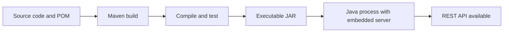

No separate Tomcat installation is required for this executable JAR.

---

## 15. Common errors and troubleshooting

| Error or symptom | Possible reason | Solution |
|---|---|---|
| Port 8080 already in use | Another process is listening on that port | Stop it or set `server.port=9090` |
| 404 Not Found | Wrong URL or undiscovered controller | Verify URL, context path and base package |
| 405 Method Not Allowed | Wrong HTTP method | Use the method declared by the controller |
| Connection refused | Application is stopped or wrong port | Start the application and inspect logs |
| Dependency resolution failure | Maven repository, network or proxy problem | Reload dependencies and check Maven settings |
| UnsupportedClassVersionError | Runtime Java is older than compiled class version | Use a compatible JDK and check IDE/Maven settings |
| Application exits immediately | No web infrastructure in a standalone application | Verify the web starter and application type |
| Whitelabel error page | Unmapped URL or processing error | Verify mappings and inspect logs |
| JSON response failure | Incompatible dependencies or serialization configuration | Check logs, managed dependency versions and model |

---

## 16. Classroom and interview questions

<details>
<summary>1. What is Spring Boot?</summary>

Spring Boot simplifies building Spring applications with conditional auto-configuration, starters, embedded servers and sensible defaults.

</details>

<details>
<summary>2. Does Spring Boot replace Spring Framework?</summary>

No. It builds on Spring Framework and uses its underlying features.

</details>

<details>
<summary>3. Can we create applications with Spring Framework without Spring Boot?</summary>

Yes. More explicit configuration and application setup may be needed.

</details>

<details>
<summary>4. Can Spring Boot run without a web server?</summary>

Yes. Batch, command-line and background applications can run without an HTTP server.

</details>

<details>
<summary>5. What is a starter dependency?</summary>

A predefined collection of related dependencies for a particular application capability.

</details>

<details>
<summary>6. What is the default servlet container for the MVC starter?</summary>

Apache Tomcat.

</details>

<details>
<summary>7. What is the default server port?</summary>

8080, unless overridden.

</details>

<details>
<summary>8. What is DispatcherServlet?</summary>

The central front controller in Spring MVC that coordinates request processing.

</details>

<details>
<summary>9. Which library converts Java objects to JSON by default?</summary>

Jackson, through the configured HTTP message converters.

</details>

<details>
<summary>10. What happens if a controller is outside the main application's base package?</summary>

It may not be detected by default component scanning. Explicit scanning or configuration may be needed.

</details>

<details>
<summary>11. What annotations are combined in @SpringBootApplication?</summary>

`@SpringBootConfiguration`, `@EnableAutoConfiguration` and `@ComponentScan`.

</details>

<details>
<summary>12. What happens if we remove the MVC web starter?</summary>

If no other dependencies provide web infrastructure, the MVC REST endpoints and normal embedded servlet web server will no longer be available.

</details>

<details>
<summary>13. What is the difference between serialization and deserialization?</summary>

Serialization converts a Java object into a representation such as JSON. Deserialization converts that representation into a Java object.

</details>

---

## 17. Hands-on assignments

- [ ] Create `employee-management-service` using Spring Initializr.
- [ ] Configure `com.durgasoft` as the base package.
- [ ] Add the Spring Web MVC starter.
- [ ] Create `EmployeeController`.
- [ ] Create a GET endpoint that returns your name.
- [ ] Create an Employee model with five fields.
- [ ] Create a GET endpoint returning five employees.
- [ ] Test the text, single-object and list endpoints in Postman.
- [ ] Change the server port from 8080 to 9090.
- [ ] Set the context path to `/ems` and test the new URL.
- [ ] Execute `dependency:tree` and identify Tomcat, Spring MVC and Jackson.
- [ ] Package the application and run the executable JAR.

### Classroom discussion

Ask students to predict the result before running each experiment:

| Experiment | Expected observation |
|---|---|
| Open `/api/employees/welcome` | Text response |
| Open `/api/employees/sample` | JSON object |
| Open `/api/employees` | JSON array |
| Open `/api/unknown` | 404 response if no matching handler exists |
| POST to `/api/employees` before implementing POST | 405 response |
| Change server port to 9090 and restart | Endpoints are now served on port 9090 |
| Stop the application and send a request | Connection fails unless another server is listening |

---

## 18. Spring Boot learning roadmap

Gradually enhance the same Employee Management Service throughout the course.

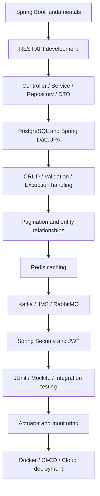

The first session establishes the foundation: how an application starts, why starter dependencies exist, how Spring MVC routes HTTP requests and how Java objects become JSON responses.

---

## 19. Official references

- [Spring Initializr](https://start.spring.io)
- [Spring Boot reference documentation](https://docs.spring.io/spring-boot/reference/)
- [Spring Boot 4.0 starter dependencies and build systems](https://docs.spring.io/spring-boot/4.0/reference/using/build-systems.html)
- [Developing your first Spring Boot application](https://docs.spring.io/spring-boot/tutorial/first-application/index.html)
- [Embedded web servers](https://docs.spring.io/spring-boot/how-to/webserver.html)
- [Spring for Apache Kafka quick tour](https://docs.spring.io/spring-kafka/reference/4.0/quick-tour.html)
- [Building a RESTful web service](https://spring.io/guides/gs/rest-service/)
- [Building an application with Spring Boot](https://spring.io/guides/gs/spring-boot/)

---

**Summary:** Spring Framework supplies the core Java application infrastructure. Spring Boot simplifies configuring, building and running Spring applications. Spring Web MVC supplies the web infrastructure needed to expose business functionality through HTTP endpoints. Together, these technologies provide a foundation for building enterprise applications and REST APIs.
