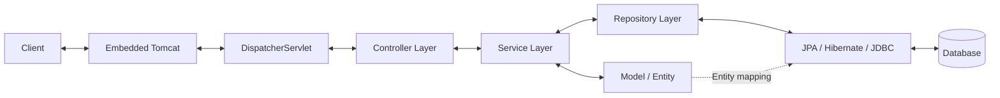
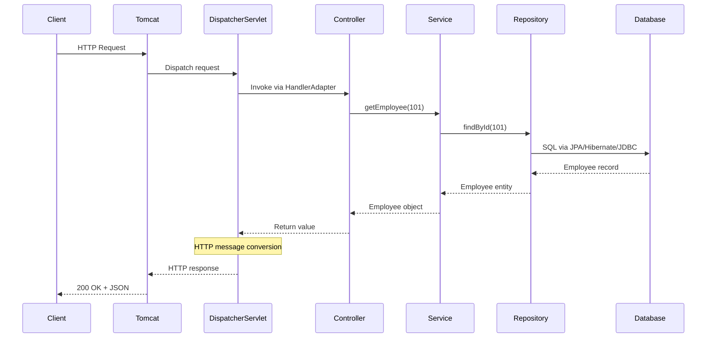
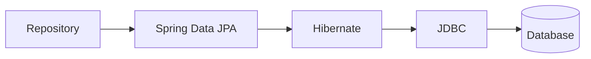

# Spring Boot Layered Architecture and Execution Flow

## 1. Introduction

Layered architecture divides an application into layers with specific responsibilities. It achieves separation of concerns, improves maintainability, and simplifies testing and development.

## 2. Architecture diagram



## 3. Components

| Component | Responsibility |
|---|---|
| Client | Sends requests and receives responses |
| Tomcat | Receives HTTP requests |
| DispatcherServlet | Coordinates Spring MVC request handling |
| Controller | Handles HTTP requests |
| Service | Implements business logic |
| Repository | Performs data access operations |
| Model / Entity | Represents application data |
| Database | Stores persistent data |

## 4. Understanding each layer

### Client

A browser, Postman, React, Angular or mobile application sends HTTP requests.

```http
GET /api/employees/101
```

### Controller Layer

Like a traffic police officer, the controller handles requests and delegates processing to the service.

```java
@RestController
@RequestMapping("/api/employees")
public class EmployeeController {
    private final EmployeeService service;

    public EmployeeController(EmployeeService service) {
        this.service = service;
    }

    @GetMapping("/{id}")
    public Employee getEmployee(@PathVariable Long id) {
        return service.getEmployee(id);
    }
}
```

### Service Layer

The processing engine of the application. It implements business rules, calculations and coordinates repository operations.

```java
@Service
public class EmployeeService {
    private final EmployeeRepository repository;

    public EmployeeService(EmployeeRepository repository) {
        this.repository = repository;
    }

    public Employee getEmployee(Long id) {
        return repository.findById(id)
            .orElseThrow(() -> new ResponseStatusException(
                HttpStatus.NOT_FOUND, "Employee not found"));
    }
}
```

### Repository Layer

Like a storekeeper, the repository retrieves, stores, updates and deletes data. Spring Data JPA creates the repository implementation automatically.

```java
public interface EmployeeRepository extends JpaRepository<Employee, Long> {
}
```

| Method | Purpose |
|---|---|
| save() | Insert or update |
| findById() | Retrieve by ID |
| findAll() | Retrieve all records |
| deleteById() | Delete a record |
| count() | Count records |
| existsById() | Check whether a record exists |

### Model / Entity

Represents application data. A JPA entity maps Java objects to relational database tables.

```java
@Entity
@Table(name = "employees")
public class Employee {
    @Id
    @GeneratedValue(strategy = GenerationType.IDENTITY)
    private Long id;
    private String name;
    private double salary;
    // Constructors, getters and setters
}
```

### Database

Stores persistent application data. Examples: PostgreSQL, MySQL, Oracle and SQL Server.

| id | name | salary |
|---:|---|---:|
| 101 | Ravi | 50000 |
| 102 | Kumar | 60000 |
| 103 | Priya | 75000 |

## 5. End-to-end execution flow

Request: `GET http://localhost:8080/api/employees/101`

1. Client sends an HTTP request.
2. Embedded Tomcat receives the request.
3. DispatcherServlet coordinates routing using Spring MVC infrastructure.
4. Controller receives the employee ID and calls the service.
5. Service processes business logic and calls the repository.
6. Repository invokes `findById(101)`.
7. Hibernate generates SQL when a database read is required and communicates via JDBC.
8. Database executes SQL and returns the record.
9. Persistence infrastructure maps the result to an Employee entity.
10. Repository returns the entity to the service.
11. Service returns the result to the controller.
12. Spring MVC uses an HTTP message converter, typically Jackson for JSON, to serialize the object.
13. Client receives the HTTP response.

Example SQL:

```sql
SELECT id, name, salary FROM employees WHERE id = 101;
```

Example response: `200 OK`

```json
{"id":101,"name":"Ravi","salary":50000.0}
```

## 6. Sequence diagram



## 7. CRUD operations

| CRUD | HTTP method | Repository method | SQL operation |
|---|---|---|---|
| Create | POST | save() | INSERT |
| Read | GET | findById() | SELECT |
| Update | PUT / PATCH | save() | UPDATE |
| Delete | DELETE | deleteById() | DELETE |

## 8. JPA and persistence

JPA (Jakarta Persistence API, formerly Java Persistence API) is a specification for managing relational data using Java objects.

| Technology | Responsibility |
|---|---|
| Spring Data JPA | Simplifies repository development |
| JPA | Defines persistence and ORM specifications |
| Hibernate | Implements JPA and performs ORM |
| JDBC | Communicates with the database |
| Database | Stores persistent data |



## 9. Real-world analogy: Online shopping

| Component | Analogy |
|---|---|
| Client | Customer requesting product information |
| Controller | Receptionist receiving requests |
| Service | Manager applying business rules |
| Repository | Storekeeper retrieving information |
| Model | Product information such as name and price |
| Database | Warehouse storing records |

## 10. Advantages

- Separation of concerns: each layer has a specific responsibility.
- Maintainability: easier to modify individual layers.
- Reusability: multiple controllers can reuse services.
- Testability: layers can be tested independently.
- Loose coupling: reduces dependencies when designed properly.
- Readability: clear code organization.
- Team development: developers can work on different layers.

## 11. Recommended project structure

```text
employee-management-service/
├── src/main/java/com/durgasoft/
│   ├── EmployeeManagementServiceApplication.java
│   ├── controller/EmployeeController.java
│   ├── service/EmployeeService.java
│   ├── repository/EmployeeRepository.java
│   └── entity/Employee.java
└── pom.xml
```

## 12. Quick revision

**Request flow:** Client → Tomcat → DispatcherServlet → Controller → Service → Repository → Database

**Response flow:** Database → Repository → Service → Controller → Web infrastructure → Client

The Model / Entity does not directly communicate with the database. The repository and persistence infrastructure perform database operations. The diagrams are simplified for classroom teaching; Java snippets omit imports and boilerplate and have not been execution-tested. Returning an entity directly is used for simplicity; DTOs are often preferable in production APIs.
